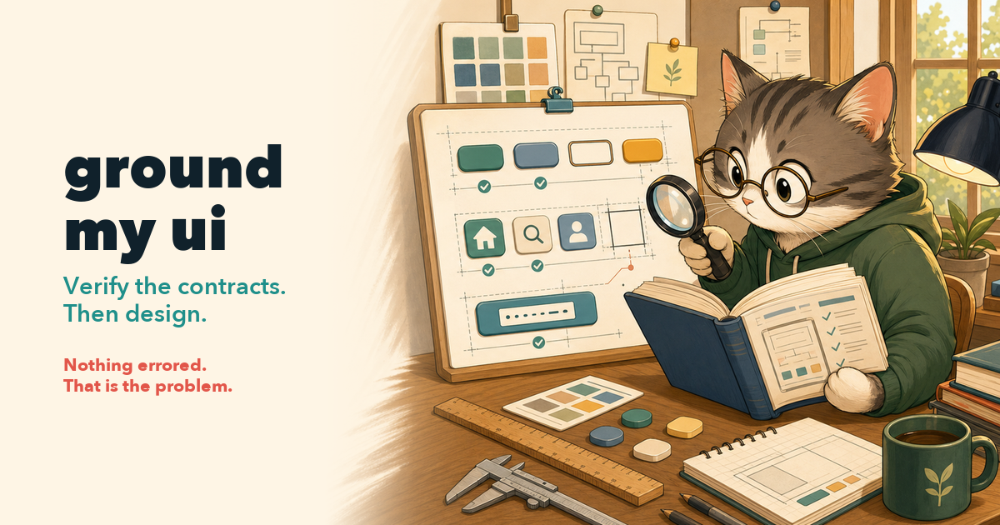

# ground-my-ui

**Most "ugly" UI is not a taste problem — it is code quietly lying to a
framework. Verify the contracts first, then design.**

`ground-my-ui` is an [agent skill](https://vercel.com/docs/agent-resources/skills)
for the failure class that raises no error: a `variant="danger"` the badge
never styled, a `#header-right` the card never read, a
`var(--scale-size-13)` that does not exist, a `display: flex` on an element
the framework positions absolutely. Nothing throws. The build passes, the
tests pass, and the page renders as a pile of half-applied intentions.

So this skill does not start with taste. It reads the **installed**
component library, token file, icon set, and translation catalog that the
screen actually runs against — then rebuilds on what is provably there, and
locks the findings into tests so the same invented prop cannot come back.

Language- and stack-agnostic: React, Vue, Svelte, Angular, Twig/PHP,
Django, Rails, SwiftUI, Compose, Flutter, .NET — inside any design system.

## How it works

```
/ground-my-ui http://localhost/admin#/reports/dashboard
```

0. **Render it first** — screenshot, then *measure* the box model
   (`width`/`gap`/`maxWidth`/`overflow`, `scrollHeight` vs `clientHeight`)
   and read the console. Misalignment you can see is a symptom; the number
   that explains it is the finding. Output: a numbered visual defect list,
   no causes yet.
1. **Locate the contract source** — the copy **on disk**, not the docs
   site: `node_modules`, a vendored framework's own `node_modules`,
   `site-packages`, `.pub-cache`, `Pods`, the Gradle cache. Plus the host
   version from the lockfile, because a contract answer is only true for a
   version.
2. **Contract audit** — every prop, enum value, slot name, token, icon
   name, and i18n key the screen touches, verified at a citable
   `file:line`. Including the check almost everyone skips: which enum
   values the library *actually styles*, versus which merely type-check.
   Then inverted — grep every key the screen references and resolve all of
   them, in **every** locale.
3. **Ownership audit** — who really owns layout, scrolling, and padding,
   and whether your selector can win (specificity ties go to whoever loads
   last, and that is the library). This is where the biggest silent
   defects live and the phase most often skipped.
4. **Design Gate** — *only now* decide what the screen should be: IA,
   host primitives, accessibility intent, and a dependency decision stated
   either way. Redundant elements get **deleted, not restyled**.
5. **Rebuild** on verified contracts — library escape hatches over custom
   CSS, platform formatters for every number and date, real links for real
   targets, meaning never carried by colour alone.
6. **Lock it in** — contract tests that fail on reintroduction, each
   naming the defect it prevents: enum values in the styled set, no
   spacing token used as a font size, every key resolving, every route
   registered.
7. **Re-verify rendered** — same measurements re-taken, console clean
   *after a reload*, wide and narrow, focus ring, one link actually
   clicked.

The deliverable is a **defect ledger**: every row citing what the code
says, what the contract says, what the user sees, and its class — so six
findings resolve into "four of them are the same root cause" instead of
six unrelated bugs.

## Why the contract audit comes before the design

Every defect below shipped through review, in real code, with a green
build:

| Code | User sees | Why nothing warned |
|------|-----------|--------------------|
| `variant="danger"` (union: `critical`) | badge present, unstyled | class built by template string; no rule, no error |
| `#header-right` (slot: `headerRight`) | button **entirely absent** | unknown slots are dropped silently |
| `font-size: var(--scale-size-13)` | no type hierarchy | undefined `var()` voids the **whole** declaration |
| `name="regular-building"` | blank square | icon resolution swallows the miss |
| `t('global.default.refresh')` | `global.default.refresh` on the button | i18n runtimes echo missing keys by design |
| `flex`/`gap` on a framework wrapper | sections jammed, double padding | valid CSS, applied to an element with one child |
| `.mine.lib-card` vs `.lib-card[data-v]` | one card narrower than its row | (0,2,0) tie — library CSS loads later |

A redesign layered on top of these makes prettier broken UI. The audit is
what makes the redesign hold.

## The skill family

| Skill | Moment |
|-------|--------|
| [know-my-repo](https://github.com/silkyland/know-my-repo) | Day one: onboard onto a repo with zero knowledge |
| [deep-plan](https://github.com/silkyland/deep-plan) | Plan the next feature/refactor — evidence-gated, 7 phases |
| [deep-plan-ingest](https://github.com/silkyland/deep-plan) | Distill an accepted plan into living knowledge files |
| [clean-slate](https://github.com/silkyland/clean-slate) | Reset rotten knowledge files — backup-gated |
| [transform-my-repo](https://github.com/silkyland/transform-my-repo) | Change the architecture: migration feasibility + strategy |
| [love-me-love-my-docs](https://github.com/silkyland/love-me-love-my-docs) | A user manual that regenerates itself |
| [seed-ah](https://github.com/silkyland/seed-ah) | Fake-but-production-like demo data with a manifest |
| [reproduce-my-bug](https://github.com/silkyland/reproduce-my-bug) | Prove the bug before anyone fixes it |
| **ground-my-ui** | Prove the UI's contracts before anyone redesigns |

Shared law: **no claim without evidence** — here, no prop, slot, token,
icon, or key you have not read in the installed source.

Pairs naturally with `reproduce-my-bug` (that skill proves a behavioural
bug; this one proves a rendering one) and with `seed-ah` (an empty screen
cannot be judged — realistic data first).

## Install

```bash
npx skills add silkyland/ground-my-ui
```

Or copy this directory into your agent's skills folder
(e.g. `~/.claude/skills/ground-my-ui/`).

## Structure

```
ground-my-ui/
├── SKILL.md                        # 7-phase workflow + hard rules (render first, verify always)
└── references/
    ├── silent-failures.md          # 12 no-error failure modes: tell, probe, fix + symptom triage
    ├── contract-discovery.md       # Where the installed truth lives, per ecosystem
    ├── css-ownership.md            # Layout owner, specificity ties, library defaults
    ├── contract-tests.md           # Guard-test patterns that fail on reintroduction
    └── audit-ledger.md             # Ledger + Design Gate brief + quality bar
```

Follows the [Vercel skills](https://github.com/vercel-labs/skills) single-skill
layout and [Anthropic's skill authoring best practices](https://platform.claude.com/docs/en/agents-and-tools/agent-skills/best-practices).

## License

MIT
